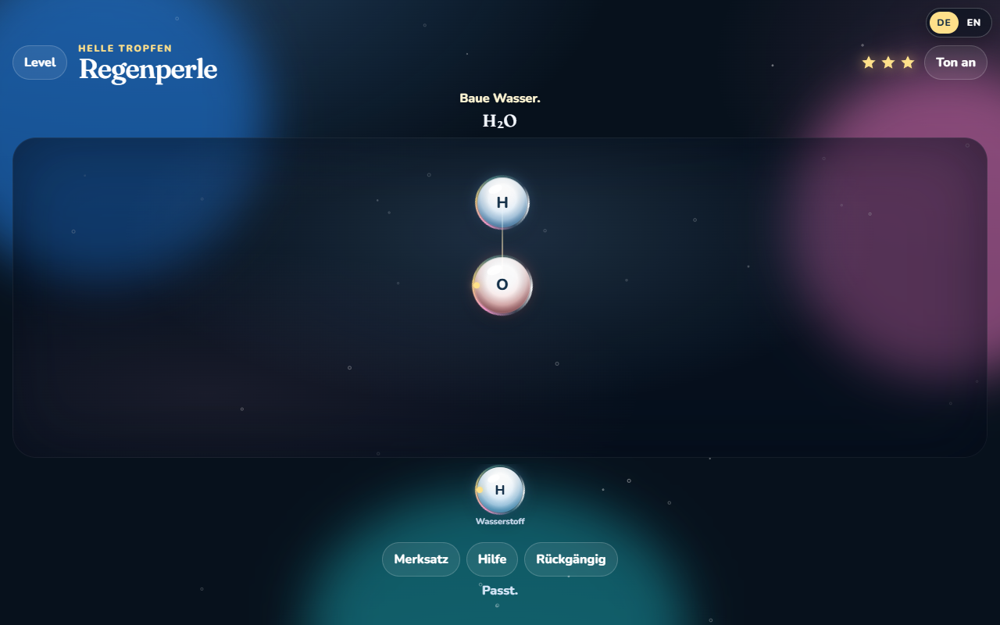

# Funkelnde Moleküle

**[Direkt spielen](https://schwarzenbergg.github.io/chemestrial/Chemestrial.html)** öffnet die fertige Einzeldatei im Browser. Es ist nichts herunterzuladen.



Ein kleines Spiel für Chemie, etwa 11 bis 13 Jahre. Berühmte Moleküle werden aus Atomen zusammengesteckt. Jedes richtige Molekül füllt den Bildschirm mit seiner eigenen Animation. Bei Wasser regnet es über die ganze Fläche.

Erstellt mit Grok 4.7.

Der Titel heißt auf Englisch Shimmering Molecules. Oben rechts stehen DE und EN. Die Wahl bleibt im Browser gespeichert. Beim ersten Öffnen gilt die Sprache des Browsers, wenn sie Englisch ist, sonst Deutsch.

## Spielen

Die bearbeitbare Fassung liegt in mehreren Dateien. Unter Windows öffnet `start.bat` die Seite. Sonst die Datei `index.html` im Browser öffnen. Es braucht keine Installation. Für die Schriftarten der mehrteiligen Fassung ist beim ersten Mal eine Verbindung zu Google Fonts nötig. Danach spielt das Spiel ohne Netz.

Zum Verschicken gibt es [`Chemestrial.html`](https://schwarzenbergg.github.io/chemestrial/Chemestrial.html). In dieser einen Datei stecken Seite, Spiel und Schriftarten. Sie läuft offline, auch per Doppelklick, und über den Link oben direkt im Browser.

So geht eine Runde:

1. Eine Band wählen: Erste Funken, Helle Tropfen, Warmes Feuer oder, nach Zeltlicht, die Küchenperle.
2. Ein Atom antippen. Es schwebt in die Schale. Das nächste Atom nahe genug heranbringen, dann steckt es sich fest. Ziehen geht auch.
3. Merksatz erklärt die Idee und kostet keinen Stern. Hilfe hebt den nächsten Schritt hervor und kostet einen Stern. Jeder Fehlversuch kostet ebenfalls einen Stern. Drei Sterne gibt es nur ohne Fehler und ohne Hilfe. Nach vier Fehlversuchen endet das Level, ohne das fertige Bild zu zeigen.

Mit `?alle=1` hinter der Adresse sind alle Level offen, auch die Küchenperle. Beispiel: `index.html?alle=1`.

## Level

| Level | Molekül | Band |
| --- | --- | --- |
| Leichter Hauch | Wasserstoff H₂ | Erste Funken |
| Frische Luft | Sauerstoff O₂ | Erste Funken |
| Stiller Himmel | Stickstoff N₂ | Erste Funken |
| Sauerperle | Chlorwasserstoff HCl | Erste Funken |
| Regenperle | Wasser H₂O | Helle Tropfen |
| Sprudel | Kohlendioxid CO₂ | Helle Tropfen |
| Stilles Ei | Schwefelwasserstoff H₂S | Helle Tropfen |
| Gartenhauch | Ammoniak NH₃ | Helle Tropfen |
| Lagerfeuer | Methan CH₄ | Warmes Feuer |
| Blasenbad | Wasserstoffperoxid H₂O₂ | Warmes Feuer |
| Zeltlicht | Propan C₃H₈ | Warmes Feuer |
| Küchenperle | Essigsäure CH₃COOH | Abschluss |

Jedes Atom hat feste Steckstellen: Wasserstoff 1, Chlor 1, Sauerstoff 2, Schwefel 2, Stickstoff 3, Kohlenstoff 4. Zwei Fäden zwischen denselben Atomen sind eine Doppelbindung, drei eine Dreifachbindung. Das Spiel zeigt nur das Bild. Es ist keine Anleitung, etwas herzustellen.

Die Küchenperle öffnet sich, wenn Zeltlicht mindestens einen Stern hat.

## Dateien

| Datei | Inhalt |
| --- | --- |
| `index.html`, `styles.css`, `i18n.js`, `logic.js`, `celebrate.js`, `app.js` | die bearbeitbare Seite |
| `start.bat` | öffnet `index.html` unter Windows |
| `Chemestrial.html` | eine Datei zum Weitergeben, auch [direkt spielbar](https://schwarzenbergg.github.io/chemestrial/Chemestrial.html) |
| `docs/oberflaeche.png` | Bild der Spielfläche |
| `pack.py` | baut `Chemestrial.html` neu |

Nach einer Änderung an den Quelldateien die Einzeldatei neu bauen:

```bash
python pack.py
node logic.js
```

Das Skript übernimmt die schon eingebetteten Schriftarten und schreibt die Seite neu. Eine eigene Kopie mit „Kopie“ im Namen bleibt lokal und gehört nicht ins Repository.

## Schriftarten und Lizenz

Der Programmcode steht unter der MIT-Lizenz, siehe `LICENSE`. Die eingebetteten Schriftarten Fraunces und Nunito stehen unter der [SIL Open Font License 1.1](https://openfontlicense.org). Fraunces: Copyright 2018 The Fraunces Project Authors. Nunito: Copyright 2014 The Nunito Project Authors.

Die MIT-Lizenz ist für dieses öffentliche Repository gewählt, damit die Datei frei weitergegeben und verändert werden darf. Sie lässt sich austauschen, indem `LICENSE` ersetzt wird.

## English

Shimmering Molecules is a chemistry game for ages 11–13. You plug atoms into famous molecules. A right answer fills the screen: rain for water, bubbles for carbon dioxide, a campfire for methane, and so on.

[Play it](https://schwarzenbergg.github.io/chemestrial/Chemestrial.html) opens the single file in the browser. You can also open `index.html` from the source, or share `Chemestrial.html` offline. Add `?alle=1` to unlock every level. The game builds pictures only. It is not a recipe for making any substance. Game code is MIT. The embedded Fraunces and Nunito fonts stay under the SIL Open Font License 1.1.

Created with Grok 4.7.
